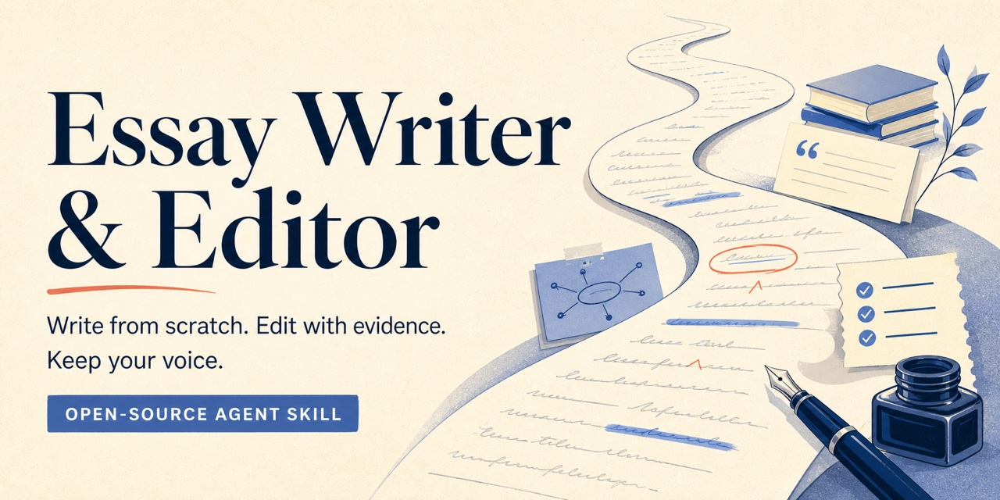

# Essay Writer & Editor

[](https://github.com/shimellism-eng/essay-writer-editor/actions/workflows/validate.yml)
[](https://github.com/shimellism-eng/essay-writer-editor/releases)
[](LICENSE)



Plan, draft and revise natural essays in your voice, with safeguards designed to reduce invented facts, sources and personal experience.

Essay Writer & Editor is an open-source Agent Skill for people who need help turning a prompt, idea, source pack or rough draft into a stronger essay. It can write an essay from scratch, edit an existing essay, review an argument, investigate a topic from several perspectives, audit repetitive prose patterns, and analyse possible AI-writing signals.

It is designed to improve the writing, not to fool an AI detector or hide required AI use.

> **Public beta:** the package and fixtures are validated, but results still vary by model, agent and prompt. The writer must check every final claim and citation.

## Install in 30 seconds

With Node.js 22.20 or newer installed, run:

```bash
npx skills add shimellism-eng/essay-writer-editor --skill essay-writer -g -y --copy
```

Start a new AI task, then try:

```text
Use $essay-writer to plan an essay about the causes of urban heat islands.
```

If this project helps your writing, [star the repository](https://github.com/shimellism-eng/essay-writer-editor) so other essay writers can find it.

## What it can do

- **Write from scratch:** turn a topic, assignment, rubric, notes or supplied sources into a complete draft.
- **Plan an essay:** interpret the prompt, develop a thesis, map the argument and build an outline.
- **Edit an essay:** make a light correction, a standard revision or a deep structural rewrite.
- **Review without rewriting:** assess the thesis, reasoning, evidence, organisation, voice and rubric fit.
- **Build an evidence ledger:** map claims, quotations, numbers, citations, source scope and limitations without guessing metadata.
- **Audit citations:** find missing, mismatched or unsupported citations and flag claims that are stronger than their evidence.
- **Review against a rubric:** map each criterion to draft evidence, status, consequence and revision priority without inventing a grade.
- **Explain revisions:** return a concise change log after an edit while preserving the writer's voice and evidence.
- **Support research:** compare practical experience, academic evidence, objections, incentives and historical precedents.
- **Check evidence:** preserve quotations, citations, numbers and uncertainty, and mark missing support instead of inventing it.
- **Analyse AI-writing signals:** return a cautious, evidence-based assessment with counterevidence and limitations.
- **Audit writing patterns:** identify recurring sentence shapes, transitions, rhythm, paragraph templates and abstraction, then repair reader-facing problems without adding artificial errors.
- **Protect the writer's voice:** retain purposeful dialect, regional spelling, code-switching and non-native expression.

It supports argumentative, analytical, expository, compare-and-contrast, reflective, narrative, application and general nonfiction essays.
It also supports personal statements, scholarship essays, lab reports and source-based literature reviews with mode-specific evidence boundaries.

## Why it is different

| Typical writing assistant | Essay Writer & Editor |
| --- | --- |
| Polishes whatever is present | Separates supplied facts, assumptions and evidence gaps |
| Replaces the writer's style with a generic house voice | Protects viewpoint, dialect, regional spelling and purposeful expression |
| Treats a detector score as proof | Reports evidence, counterevidence, uncertainty and limitations |
| Produces one smooth consensus | Tests practical, academic, skeptical, financial-incentive and historical perspectives |
| Requires an existing draft | Can plan and write from a topic, brief, notes, rubric or source pack |

## What its instructions prohibit

Essay Writer & Editor instructs the model not to:

- invent a source, quotation, statistic, event, credential or personal memory;
- guarantee a grade, originality score or plagiarism result;
- promise that writing is “undetectable” or “guaranteed human”;
- prove who or what wrote a passage from its wording alone;
- help conceal AI use when disclosure is required;
- silently change a quotation, citation, factual claim or the writer's position.

The writer remains responsible for checking the final work and following the rules of their school, university, publication or workplace.

## Start here

After installation, begin a request with `Use $essay-writer`.

### Write an essay from scratch

```text
Use $essay-writer to draft a 1,200-word argumentative essay answering the
prompt below. Use only the sources I provide. Mark any claim that still
needs evidence, and use UK English.

[prompt, rubric and sources]
```

If important information is missing, the skill asks only when the answer would materially change the essay. Otherwise it proceeds with a clearly labelled assumption or evidence gap.

### Improve an existing essay

```text
Use $essay-writer in standard edit mode. Strengthen my thesis and paragraph
flow, but preserve my viewpoint, examples and voice. Do not alter quotations.

[essay]
```

For a smaller intervention, request a **light edit**. If the argument or organisation needs rebuilding, request a **deep edit**.

### Plan before drafting

```text
Use $essay-writer to interpret this assignment, propose a working thesis,
identify counterarguments and make a paragraph-by-paragraph outline.

[assignment]
```

### Review against a rubric

```text
Use $essay-writer to review this essay against the rubric. Do not rewrite it.
Give me the three revisions that would make the biggest difference.

[rubric and essay]
```

### Build an evidence ledger and audit citations

```text
Use $essay-writer in Evidence mode. Do not rewrite this paragraph. Build a
claim-source ledger and audit every quotation, citation, number and causal
claim. Flag missing metadata instead of guessing it.

[draft and sources]
```

### Edit with a revision history

```text
Use $essay-writer to give this a standard edit. Return the revised essay first,
then a concise revision history explaining material changes. Preserve my voice,
quotations, citations, numbers and uncertainty.

[essay]
```

### Use a specialised writing mode

```text
Use $essay-writer in [personal statement / scholarship essay / lab report /
literature review] mode. Use only the supplied material, follow the mode's
evidence rules, and mark any detail that I still need to provide.

[prompt, notes, data or sources]
```

### Research from several viewpoints

```text
Use $essay-writer in research mode. Examine this question through the
practitioner, academic, skeptic, incentives and historian lenses. Map the
main contradictions before giving me a synthesis.

[research question]
```

### Analyse possible AI-writing signals

```text
Use $essay-writer in detect mode. Analyse the text for possible AI-writing
signals. Quote the relevant passages, include counterevidence and explain
the limitations. Do not rewrite it.

[text]
```

### Audit and repair repetitive patterns

```text
Use $essay-writer in Pattern mode. Identify recurring sentence, transition,
rhythm and paragraph patterns in this passage. Then repair only the patterns
that reduce clarity or erase the writer's voice. Use descriptive observations,
not invented statistics, and do not optimise for an AI detector.

[text]
```

## Modes

| Mode | Best for | Typical result |
| --- | --- | --- |
| Plan | A prompt, question or early idea | Thesis, argument map, outline and evidence gaps |
| Draft | Writing from scratch | Complete essay plus material assumptions or missing evidence |
| Edit | Improving an existing essay | Light, standard or deep revision |
| Review | Feedback without a rewrite | Prioritised assessment against the prompt or rubric |
| Research | A disputed or complex topic | Multi-perspective research map and synthesis |
| Detect | Examining writing patterns | Cautious assessment, evidence, counterevidence and limitations |
| Pattern | Auditing or repairing repetitive prose | Pattern inventory, limitations and reader-focused repair |
| Evidence | Mapping claims to sources and auditing citations | Evidence ledger, citation findings and unresolved support gaps |
| Personal statement | Application writing grounded in supplied experience | Supported choices, values and reflection |
| Scholarship essay | Selection-criteria writing | Evidence-bounded fit, contribution and goals |
| Lab report | Practical and laboratory writing | Method, results, analysis, uncertainty and limitations |
| Literature review | Synthesis across sources | Source comparison, contradictions, scope and gaps |

Modes can be combined. For example, `Plan → Draft → Review` develops an essay and then checks the result.

## About AI-writing signal analysis

No text-only detector can reliably establish authorship. Human writing and AI-assisted writing can both show statistical or structural patterns, while irregular prose can come from editing or collaboration. Short, translated, technical, formulaic, multilingual and mixed-authorship texts are particularly difficult to assess fairly.

Detect mode therefore reports one of four assessments:

- `human-leaning`
- `mixed or uncertain`
- `AI-leaning`
- `insufficient text`

It also reports `low`, `moderate` or `high` confidence, quotes the signals it found, gives counterevidence and explains why it may be wrong. It does not assign a made-up probability.

As a conservative default:

- fewer than 200 words normally receives `insufficient text`;
- 200–499 words cannot receive more than `low` confidence from writing patterns alone;
- style alone cannot justify `high` confidence;
- conflicting signals reduce confidence.

Use this analysis as a reason to review provenance or talk with the writer, never as the sole basis for a disciplinary, employment, admissions or publication decision.

The feature categories, confidence rules and scoped research notes are documented in the [AI-writing signal reference](skills/essay-writer/references/ai-writing-signals.md).

## Installation

This repository contains one skill named `essay-writer`. The installation route depends on the AI tool you use.

### Skills CLI

The current Skills CLI requires Node.js 22.20 or newer. Install directly from GitHub:

```bash
npx skills add shimellism-eng/essay-writer-editor --skill essay-writer -g -y --copy
```

To inspect the remote package before installing:

```bash
npx skills add shimellism-eng/essay-writer-editor --list
```

To choose among agents recognised by your installed version of the CLI, omit `-y` and follow its prompts. CLI recognition means the files can be placed for that agent; it does not by itself prove that every feature has been behaviourally tested in every agent version.

You can also clone or download the repository, open a terminal in its folder and replace the GitHub repository name in either command with `.`.

### Codex native skill

For a manual Codex installation:

1. Copy the entire `skills/essay-writer` folder.
2. Paste it inside your user Agent Skills folder.
3. Confirm the final path is:
   - macOS or Linux: `~/.agents/skills/essay-writer/SKILL.md`
   - Windows: `%USERPROFILE%\.agents\skills\essay-writer\SKILL.md`
4. Start a new Codex task so it can discover the skill.

Some existing Codex installations also recognise the legacy `~/.codex/skills` location. Use `.agents/skills` for a new portable installation unless your installed Codex documentation says otherwise.

Then try:

```text
Use $essay-writer to plan an essay about the causes of urban heat islands.
```

### Other Agent Skills-compatible tools

Some versions of Claude Code, Cursor, Gemini CLI and other agents can discover Agent Skills folders directly or through the Skills CLI. Install with the CLI's agent selection prompt, then run the verification request below. Support changes between products and versions, so this beta does not claim universal runtime compatibility.

### ChatGPT and other manual adaptations

This repository is not a one-click ChatGPT skill. Where your tool permits reusable project or custom instructions, you can adapt it manually:

1. Copy the instructions from `skills/essay-writer/SKILL.md`.
2. Add the relevant files from `skills/essay-writer/references` to the same project or instruction set.
3. Keep the factual-integrity, academic-integrity and detection-limit sections intact.
4. Test the adaptation with the verification requests below.

Features such as web research, file access and persistent instructions depend on the tool and plan you use.

### Compatibility status

| Environment | Route | What this repository claims |
| --- | --- | --- |
| Codex | Native skill folder or Skills CLI | Designed and structurally validated for the Codex skill format; verify behaviour in your installed version |
| Agent Skills-compatible tools | Skills CLI or the tool's documented skill folder | Package format is available; runtime support and behaviour vary by tool and version |
| ChatGPT | Manual adaptation | Instructions can be adapted where reusable instructions are supported; this is not a native installation claim |
| Other AI assistants | Manual adaptation | May work when the tool accepts system or project instructions and supporting files; not certified by this beta |

### Verify the installation

Run these three requests in a new task:

```text
Use $essay-writer to outline a short argumentative essay. Label any evidence
I would still need.
```

```text
Use $essay-writer to edit this sentence lightly without changing its meaning:
“I kept the awkward sentence because it sounds like me.”
```

```text
Use $essay-writer in detect mode on this 30-word passage.
```

A working installation should recognise the requested mode, preserve the meaning of the sentence and treat the very short detection sample as insufficient rather than inventing a confident verdict.

### Update, roll back or uninstall

- **Update with Skills CLI:** run `npx skills update essay-writer -g` when the CLI reports the installation as updateable.
- **Update a manual copy:** download the new release and replace the existing `essay-writer` folder after saving any personal changes.
- **Roll back:** restore the `essay-writer` folder from a release or backup you trust, then start a new task.
- **Uninstall with Skills CLI:** run `npx skills remove essay-writer -g -y`.
- **Uninstall manually:** remove only the `essay-writer` folder from your agent's skills directory, then start a new task.

If the skill is not discovered, confirm that the folder is not nested twice, that the file is named `SKILL.md`, and that you opened a new task after installation.

## How it protects an essay

Before drafting or editing, the skill separates supplied facts from assumptions and unsupported claims. It preserves direct quotations exactly, keeps numbers attached to their units and populations, and marks source gaps instead of polishing guesses into facts.

For a substantial essay, it checks:

- whether the thesis actually answers the prompt;
- whether each paragraph has a useful purpose;
- whether evidence supports the claim made from it;
- whether counterarguments are represented fairly;
- whether transitions follow the reasoning instead of a repeated template;
- whether sentence rhythm and paragraph shape have become mechanical;
- whether the conclusion earns its emphasis without merely repeating the introduction;
- whether the writer's voice, dialect and level of certainty survived the edit.

This can help humanize an essay by making it more specific, purposeful and recognisably individual. It does not add fake mistakes, random tangents or invented anecdotes.

## Privacy

The skill itself is Markdown-only at runtime and does not send an essay to an additional detection or rewriting service. Your chosen AI agent may still process the text according to its own settings and privacy terms. Do not submit confidential, personally identifying or unpublished material unless you are authorised to use it with that provider.

## Evaluation

The repository includes package checks and behavioural cases covering drafting, editing, evidence ledgers, citation audits, rubric review, revision history, specialised writing, voice protection, prompt injection, unsafe bypass requests and conservative AI-signal analysis.

Static validation can confirm files, metadata and test fixtures. It cannot prove that every model will behave identically or that detection is accurate. The project will not publish an accuracy claim without a labelled, versioned, essay-specific benchmark.

## Contributing and support

Contributions that improve essay quality, factual integrity, accessibility, false-positive resistance or installation clarity are welcome. Start with [CONTRIBUTING.md](CONTRIBUTING.md), and read the [Code of Conduct](CODE_OF_CONDUCT.md).

For help, see [SUPPORT.md](SUPPORT.md). Please report security or privacy concerns through the process in [SECURITY.md](SECURITY.md).

Questions and examples that do not contain private writing are welcome in [GitHub Discussions](https://github.com/shimellism-eng/essay-writer-editor/discussions).

## Licence

Essay Writer & Editor is available under the [MIT License](LICENSE).
